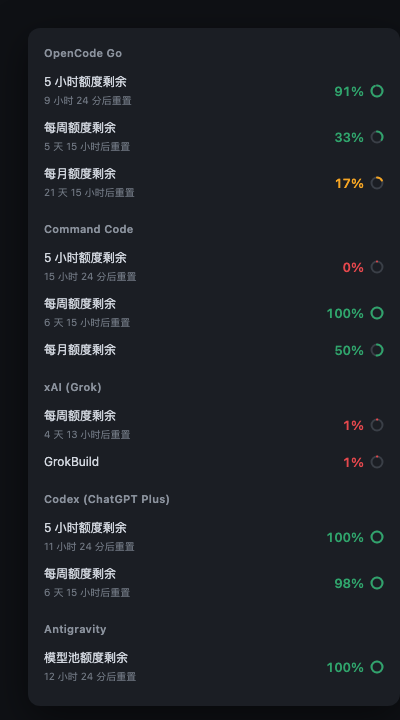

# dsh-quota-pill

A quota pill for the [DeepSeek Harness](https://github.com/deepseek-ai) web GUI:
**how much is left** on every LLM subscription you have, in one collapsible pill
next to the composer.



It sits in the composer toolbar, shows the tightest window at a glance, and opens
into a per-provider breakdown with reset times. Switch sessions and it follows
the model — showing that provider's last reading while it refreshes, then easing
into the live number.

## What it reads

| Provider | Credential |
|---|---|
| **DeepSeek** (official) | the Platform sign-in DSH already holds — nothing to add |
| **Kimi Coding** | `refs.KIMI_CODING_API_KEY` in `~/.dsh/.credentials.yaml` |
| **OpenCode Go** | `refs.OPENCODE_GO_API_KEY` |
| **Command Code** | `refs.COMMANDCODE_API_KEY` or `refs.COMMANDCODE_GOAT_API_KEY` (DSH names it after its `apiKeyEnv`) |
| **xAI (Grok)** | OAuth token from [CLIProxyAPI](https://github.com/router-for-me/CLIProxyAPI) |
| **Codex (ChatGPT Plus)** | same — and CLIProxyAPI must be **running** |
| **Antigravity** | same |
| **Open Design** (optional) | `refs.OPENDESIGN_CONTROL_KEY` (`vela_ctrl_…`) + `refs.OPENDESIGN_WORKSPACE_ID`; a console session cookie (`OPENDESIGN_SESSION_COOKIE`) also works as a fallback |

**DeepSeek works with no setup at all** if you are signed in to DeepSeek Platform
in DSH — that is the official account, and it is the one most users care about.

The three API-key providers need nothing but the key. The three OAuth providers
need CLIProxyAPI installed and logged in, because that is what holds the tokens;
this plugin only reads them and never runs an OAuth flow itself.

Every provider is optional, and **only the ones you actually have are listed**:
the pill reads DSH's `session/modelCatalog` to learn which providers the app can
route to, so removing a provider from DSH removes it from the pill too. A provider
that is present but has no credential is skipped rather than shown as an empty row.

### What "auto-detect" means

- **A new key for a supported provider** (e.g. adding `OPENCODE_GO_API_KEY`)
  appears on the next All refresh — no DSH restart, no sidecar restart.
- **A provider newly added to DSH's catalog** appears within the 2-minute catalog
  TTL, or immediately when you press **Refresh** / reopen the All page (a forced
  read drops the catalog cache). The All page also re-reads when DSH regains focus.
- **A brand-new provider type** that is not one of the eight adapters needs a
  **user adapter** in `~/.dsh/quota-pill/adapters/` (see below); a catalog entry
  alone cannot invent its quota API.

### Unknown providers and user adapters

If the Current page cannot read the session's provider, it shows a short hint and
a **复制提示词 / Copy prompt** button. The copied prompt contains the whole
adaptation flow; paste it into a new session and an agent can add the provider
without touching package files.

User adapters live in:

```text
~/.dsh/quota-pill/adapters/<provider>.mjs
```

They are outside the npm package, so **updating the plugin never overwrites
them**. The sidecar discovers a new/changed file on the next Refresh (no restart).
`/setup?fresh=1` reports `unadaptedCatalog` and `userAdapters`, and after a
plugin update the same check tells the agent which providers still need an
adapter. The module contract (exports, `read(ctx)`, standard kinds) is documented
in [`src/user-adapters.js`](src/user-adapters.js) and in AGENTS.md §2b.

## Install

**DSH Desktop (recommended).** Open **Plugins → Install**, paste a spec, enable
the bundle. **Pin the version**: an unpinned install can resolve 0.2.2, which
breaks web boot. 0.2.12 is the first version with every provider, Open Design
Control Keys, sidecar auto-start, and **user-defined adapters** for providers the
package does not ship.

```text
@hystudio/dsh-quota-pill@0.2.12
```

0.2.12 is published on npm. If pnpm's minimumReleaseAge rejects this fresh
release, install the branch until it ages:

```text
github:598934321/dsh-quota-pill#master
```

**CLI.** If `dsh` is not on PATH, open DSH Desktop → Settings → **Manage dsh
Command** first. Then:

```bash
dsh plugin add @hystudio/dsh-quota-pill@0.2.12
```

> The npm package is `@hystudio/...` while the repo lives at `598934321/...` —
> they are the same author under two account names.

**The sidecar now starts automatically with the plugin** (the host half spawns it
when nothing is listening on :8319), so there is no second command for a normal
desktop install. If you prefer to manage it yourself, run
`npx @hystudio/dsh-quota-pill` or a service unit — see
[Running it as a service](#running-it-as-a-service).
The pill says **"quota service is not running"** only if :8319 is still closed a
few seconds after DSH starts.

Then add whichever keys you have:

```yaml
# ~/.dsh/.credentials.yaml
refs:
  KIMI_CODING_API_KEY: sk-...
  OPENCODE_GO_API_KEY: sk-...
  COMMANDCODE_API_KEY: sk-...
```

Reload the DSH window. Done.

### Let an agent do it

The repo ships [`AGENTS.md`](AGENTS.md) — a step-by-step guide written for an AI
agent. Ask your agent to set the plugin up and it will detect what you already
have, ask only for what it cannot know (your keys), write them safely, and verify
each provider end to end.

```text
Read AGENTS.md in this repo and set up dsh-quota-pill for me.
```

## Running it as a service

The host plugin already starts the sidecar; this section is only for users who
want it independent of DSH (server, headless, multiple app profiles). Set
`QUOTA_PILL_NO_AUTOSTART=1` so the plugin does not race the service.

`npx` in a terminal dies with the terminal. Pick one:

**macOS (launchd)** — `~/Library/LaunchAgents/dev.quota-pill.plist`

```xml
<?xml version="1.0" encoding="UTF-8"?>
<!DOCTYPE plist PUBLIC "-//Apple//DTD PLIST 1.0//EN"
  "http://www.apple.com/DTDs/PropertyList-1.0.dtd">
<plist version="1.0"><dict>
  <key>Label</key><string>dev.quota-pill</string>
  <key>ProgramArguments</key>
  <array>
    <string>/usr/bin/env</string><string>node</string>
    <string>/absolute/path/to/bin/quota-pill-server.js</string>
  </array>
  <key>RunAtLoad</key><true/>
  <key>KeepAlive</key><true/>
</dict></plist>
```

```bash
launchctl load ~/Library/LaunchAgents/dev.quota-pill.plist
```

**Linux (systemd)** — `~/.config/systemd/user/quota-pill.service`

```ini
[Unit]
Description=dsh-quota-pill sidecar

[Service]
ExecStart=/usr/bin/env node /absolute/path/to/bin/quota-pill-server.js
Restart=always

[Install]
WantedBy=default.target
```

```bash
systemctl --user enable --now quota-pill
```

## How it works

```
DSH web GUI
   └─ client.js          renders the pill; never sees a credential
        │  HTTP (localhost)
        ▼
      sidecar           reads ~/.dsh/.credentials.yaml and ~/.cli-proxy-api/*.json,
                        calls each provider's quota endpoint, caches 60s
```

Two processes because credentials must never reach the browser, and because
upstream calls need real timeouts and a TLS stack Node's `fetch` does not have
for some hosts.

### Endpoints

| Path | Purpose |
|---|---|
| `GET /health` | liveness + provider list |
| `GET /quota?model=<id>` | one provider's reading, selected by model prefix |
| `GET /quota/all` | every provider, concurrently |
| `GET /setup` | what each provider still needs |

`?fresh=1` bypasses the 60-second cache.

### Response

```jsonc
{
  "kind": "subscription-quota",   // subscription-quota | payg | none | probe-failed
  "provider": "opencode",
  "displayName": "OpenCode Go",
  "remainingPct": 17,             // remaining, never used
  "window": "monthly",            // the binding window
  "resetAt": "2026-11-12T00:00:00.000Z",
  "products": { "rolling": 9, "weekly": 67, "monthly": 83 },  // per-window used%
  "windows": [                    // one row each in the UI
    { "key": "monthly", "remainPct": 17, "resetAt": "..." }
  ],
  "cached": false,
  "at": 1792500000000
}
```

`kind` is meant to be exhaustive so the UI never has to guess:

- `subscription-quota` — a real percentage exists
- `payg` — metered billing, no ceiling (shows spend, not a percentage)
- `none` — not configured; `error` names the missing credential
- `probe-failed` — configured but the upstream call failed

## Notes on specific providers

**Codex** is read through CLIProxyAPI's management API, which reports the
`X-Codex-*` headers CLIProxyAPI observed while proxying real traffic. The direct
`chatgpt.com/backend-api/codex/usage` endpoint sits behind Cloudflare and rejects
non-browser TLS fingerprints, so it only works as a fallback. CLIProxyAPI must be
*running*, not merely installed.

**xAI** has three account generations: grandfathered plans report a percentage
directly, current plans only reveal allowance in `x-ratelimit-*` response headers
of a one-token completion, and unified-billing accounts have no ceiling at all
(reported as `payg`).

**Antigravity** shares one quota pool across all Gemini models, so it reports a
single aggregate row — per-model rows would all be the same number and the label
would flicker between models you do not even have configured.

**Command Code** does not expose a monthly ceiling. The adapter derives it from
`monthlyCap = weekly.cap × 2`, an identity verified against two different plans
(31.6 + 38.4 = 70 with `weekly.cap` 35; 0.225 + 9.775 = 10 with `weekly.cap` 6).

**Open Design** keeps its allowance in the cloud control plane, not in the
`sk-amr-…` inference key. The preferred credential is a **Control Key**
(`vela_ctrl_…`), which is accepted by the Bearer-only
`/billing/preflight` and `/wallet/balance` endpoints alongside
`x-vela-workspace-id`. Get one with the bundled device sign-in (the same flow
as the official `vela login`):

```bash
npx -p @hystudio/dsh-quota-pill dsh-quota-pill-opendesign-login --write
```

It prints an activation URL, waits for you to approve it in a signed-in browser,
then writes `OPENDESIGN_CONTROL_KEY` and `OPENDESIGN_WORKSPACE_ID` into
`~/.dsh/.credentials.yaml`. The workspace id is optional when using a Control
Key — it is otherwise resolved from `/workspaces/current`.

The older console-session route (`__Secure-better-auth.session_token` cookie,
browser-session-only `/billing/coding-plan-usage`) is still supported as a
fallback; that cookie is HttpOnly, so copy it from devtools → Application →
Cookies. Both routes go through system curl because Cloudflare rejects Node's
TLS fingerprint on `amr-api` with `error code: 1010`.

**DeepSeek** is a prepaid CNY wallet, so there is no percentage to show — the pill
shows the balance and, separately, any bonus credit. Two traps worth recording:
the stored credential is a *Platform login grant*, not an `api.deepseek.com` API
key (sending it there returns 401), and calling `platform.deepseek.com` directly
returns 429 from Cloudflare. The balance is therefore read through DSH's own
`account/getBalance` RPC, which already holds the grant and projects the response
down to wallet currency and balance. We never handle the Platform token ourselves.

## Privacy

- Credentials are read from disk, used for the upstream call, and never logged.
- The sidecar binds `127.0.0.1` only.
- Nothing is sent anywhere except the provider's own quota endpoint.
- The client shows no credential, and the sidecar's JSON carries no token.

## Development

```bash
git clone https://github.com/598934321/dsh-quota-pill
cd dsh-quota-pill
npm test              # 70 tests, offline
npm start             # sidecar on :8319
```

Tests are offline by design: they point the credential layer at a nonexistent
directory so they never touch a live account. Fixtures in `test/fixtures.js` are
synthetic — no real emails, account ids, or balances.

## License

MIT
